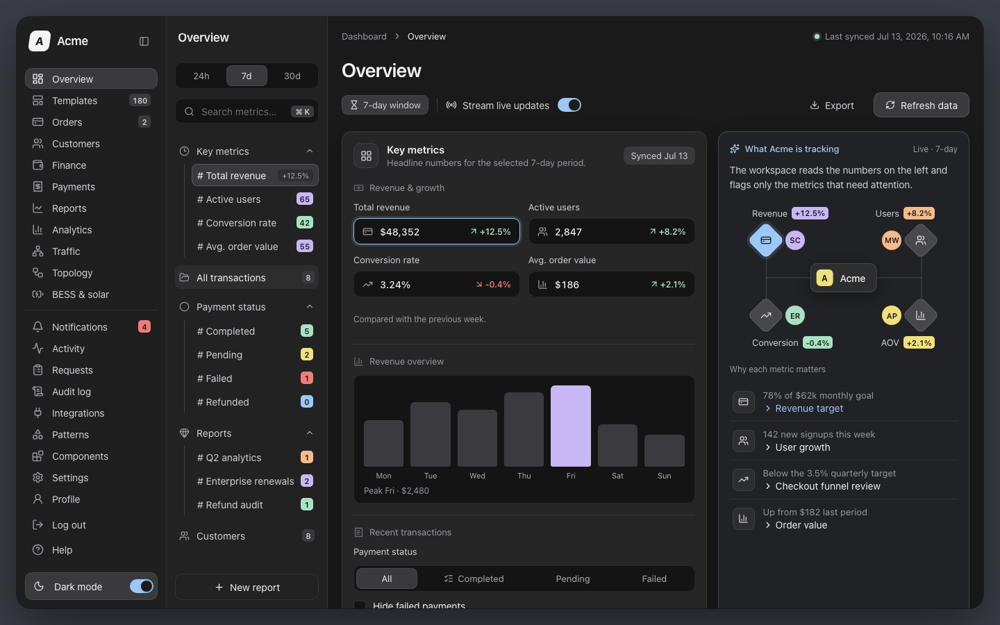
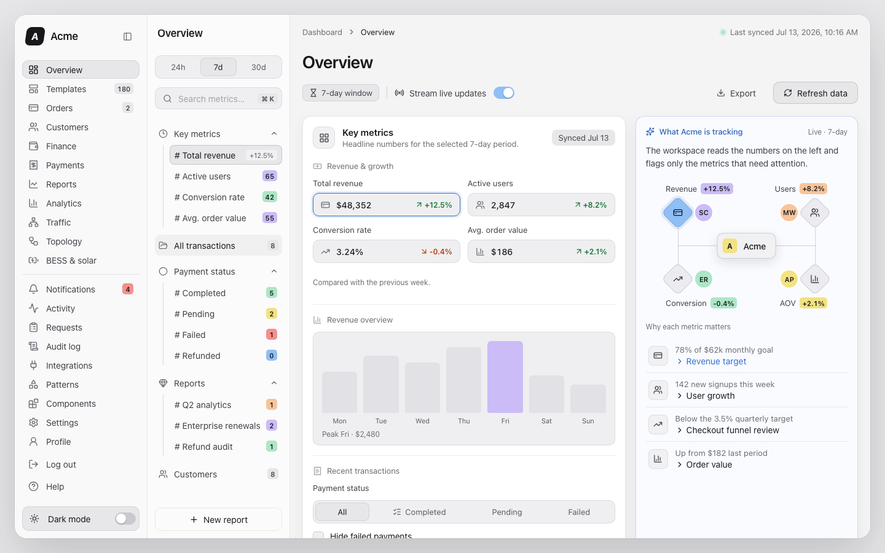
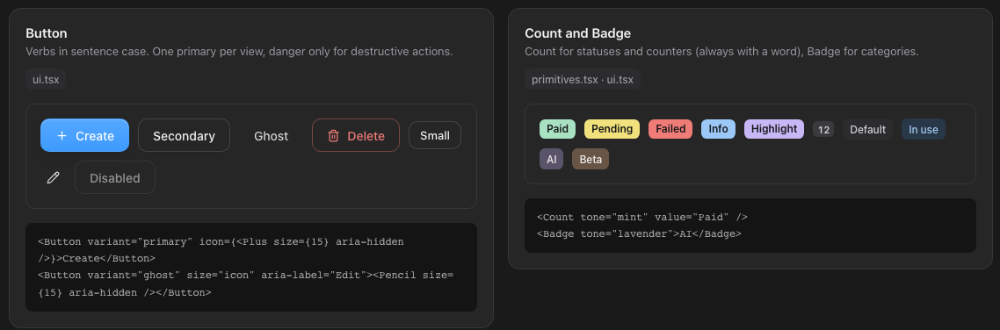
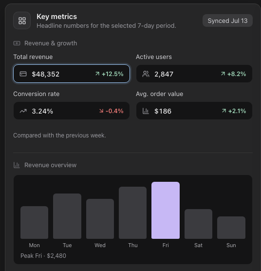
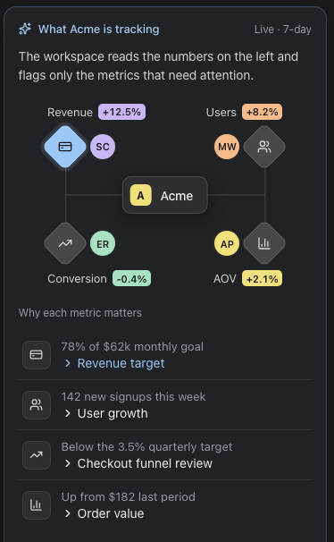
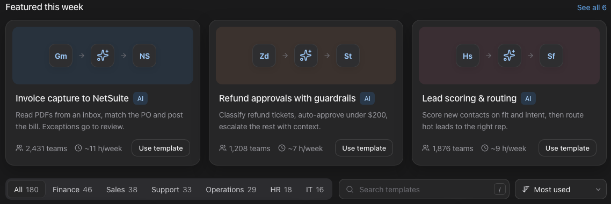
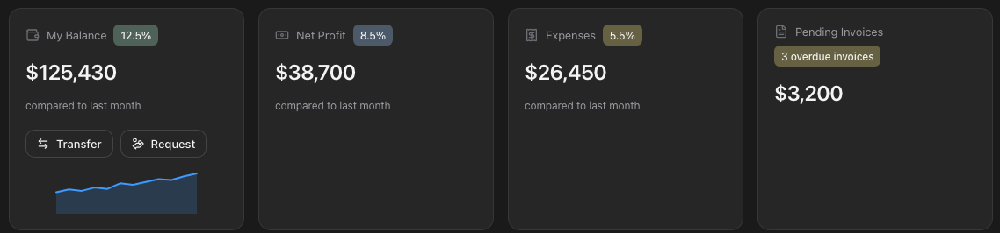
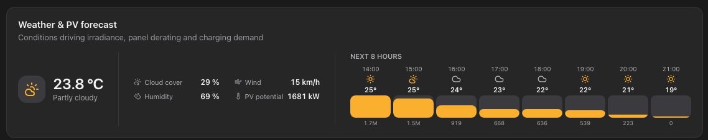
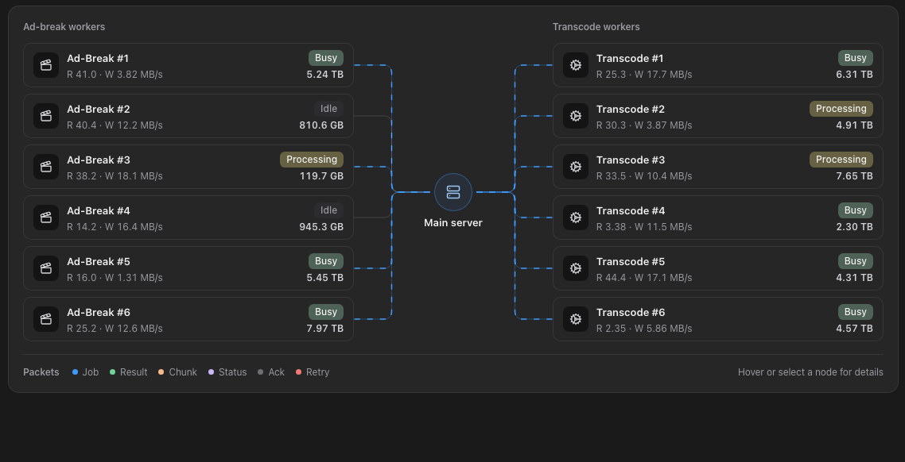
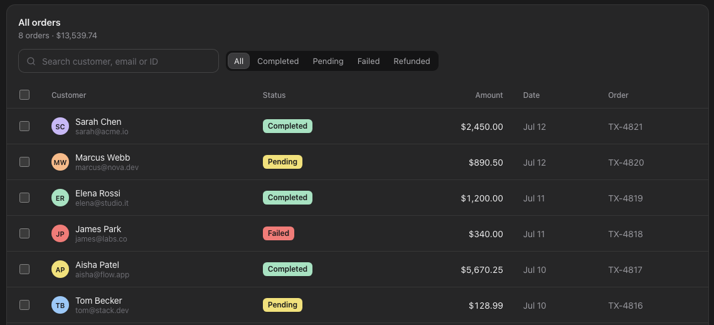

# Acme dashboard

The Overview dashboard from `~/shacdn`, rebuilt in the **Acme UI** design system (Linear-style
minimal SaaS, light + dark), plus a **Templates** screen and working screens for every sidebar item.

- Design rules for people and AI agents: [`DESIGN.md`](./DESIGN.md)
- Agent entry point: [`AGENTS.md`](./AGENTS.md) (also wired into `CLAUDE.md`,
  `.cursor/rules/acme-ui.mdc`, `.github/copilot-instructions.md`)

```bash
npm install
npm run dev      # http://localhost:5180
npm run build    # type-check + production build
npm run verify   # full quality gate: lint, design lint, tests, build, browser matrix (see AGENTS.md)
```

## Design Preview

### Full Dashboard (`Overview` — Dark & Light Themes)



<details>
<summary><strong>View Light Theme (<code>data-theme="light"</code>)</strong></summary>

<br />



</details>

### Component Close-Ups

#### 1. Core Primitives (`Button`, `Count`, `Badge`)
Sentence-case action verbs, a single primary button per view, and semantic status pills (`Count` for counters/statuses, `Badge` for categories) built strictly on theme tokens (`src/components/ui.tsx`, `src/components/primitives.tsx`).



#### 2. Key Metrics, Revenue BarChart & Live Insights Hub
Interactive KPI selector tiles paired with a 7-day `BarChart` and a live relationship graph (`What Acme is tracking`) using `Avatar` and semantic delta pills (`src/pages/OverviewPage.tsx`).

| Key Metrics & 7-Day Revenue Chart | Live Insights Hub & Metric Graph |
|---|---|
|  |  |

#### 3. Workflow Cards & `AppChip` Integration Monograms
Featured automation templates using neutral `AppChip` monograms instead of third-party vendor logos (`DESIGN.md §8`), paired with category tabs, `/` keyboard search, and sort controls (`src/pages/TemplatesPage.tsx`).



#### 4. Finance KPI Strip & BESS Telemetry Forecast
Compact metric cards with inline SVG `Sparkline`, quick action buttons, and 8-hour solar irradiance bars (`src/pages/Finance/FinancePage.tsx`, `src/pages/Bess/BessPage.tsx`).





#### 5. Interactive Pipeline Topology
Live node-and-wire media pipeline diagram with animated packet flow, worker throughput stats, and node inspection (`src/pages/Topology/PipelineTopologyDiagram.tsx`).



#### 6. Data Table with Segmented Filter & Status Pills
Searchable, filterable orders table with multi-select bulk actions, pastel `Avatar` initials, and semantic `Count` status badges (`src/pages/OrdersPage.tsx`).



## Screens (all in the left sidebar)

| Route | What works |
|---|---|
| `/overview` | KPIs, revenue chart, status filter, live toggle, refresh/export |
| `/templates` | Featured (see all), category tabs, search (`/` focuses it), sort, template preview, *Use template* flow with app connections, *Create workflow*, *Submit a template* |
| `/orders` | Search, status filter, multi-select + bulk complete/refund, order drawer — rail badge = pending orders |
| `/customers` | Search, plan filter, inline plan change, invite (validated), remove |
| `/finance` | KPI sparklines, expenses chart (3/6 months), income donut, income/expense filter |
| `/payments` | Plan meters, change plan, add card (formatted & validated), default/remove card, invoices with *Pay now* |
| `/analytics` | Conversion funnel, cohort retention, channel attribution, experiment breakdown |
| `/traffic` | Live traffic sources, latency percentiles, edge PoP status, geographic distribution |
| `/topology` | Interactive pipeline topology diagram with live packet flow, pause/resume, node inspection |
| `/bess` | Battery Energy Storage System (BESS) telemetry, power flow, inverter matrix, 24h schedule |
| `/activity` | Live workspace activity feed, severity filter, alert thresholds |
| `/requests` | Access & change requests queue, status filter, approval drawer |
| `/audit-log` | Immutable security & workspace audit log, action filter, event inspection drawer |
| `/integrations` | Connected apps catalog, category filter, configuration drawer |
| `/patterns` | Reusable SaaS UI patterns (empty states, onboarding checklists, danger zones) |
| `/components` | Interactive Acme UI component gallery and token reference |
| `/reports` | Generate report (async), scheduled digests on/off, download/delete |
| `/notifications` | Grouped inbox, filters, mark read / all read, dismiss — rail badge = unread |
| `/settings` | Workspace, appearance (Light/Dark/System), notifications, security; sticky save bar |
| `/profile` | Edit details, change password, 2FA, active sessions |
| `/help` | FAQ search, contact form; **Log out** opens a confirm dialog → `/signed-out` |

## Themes

Light and dark palettes live in `src/styles/globals.scss` (`:root[data-theme=…]`); SCSS tokens in
`src/styles/tokens.scss` point at those CSS variables. The choice (`light` / `dark` / `system`) is
stored in `localStorage` and applied before React mounts, so there is no flash.

## Responsive

Breakpoints in `src/styles/_breakpoints.scss`: phone `< 640` · tablet `640–1023` · desktop `≥ 1024`.

- **Desktop** — full sidebar (collapsible with the panel button), multi-column grids.
- **Tablet** — icon-only sidebar with badges, 2-column grids, featured templates become a swipe row.
- **Phone** — top bar with menu button; the sidebar slides in as a drawer. Single-column layouts,
  tables scroll sideways and hide secondary columns, dialogs open as bottom sheets.

## Structure

```
src/
  main.tsx              router
  layout/Shell.tsx      sidebar + phone top bar + logout dialog + toasts
  layout/Page.tsx       page scroll container
  lib/app.tsx           shared state: theme, notifications, orders, toasts
  components/ui.tsx     Button, Badge, Panel, Modal, Drawer, inputs, tabs, app chips…
  components/primitives.tsx  Switch, Segmented, Count, Avatar… (Overview kit)
  pages/*               one file per screen
  content/*             templates catalog + data adapted from shacdn
```
